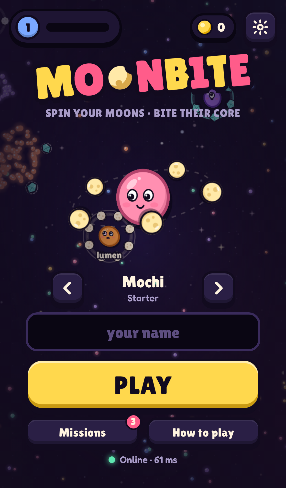
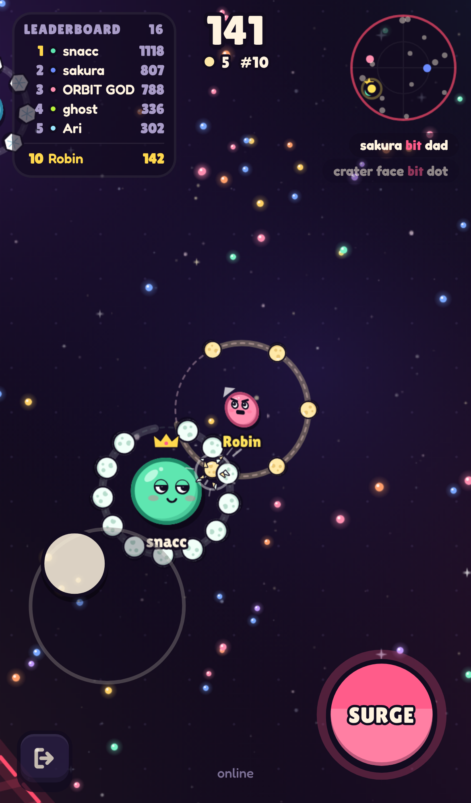
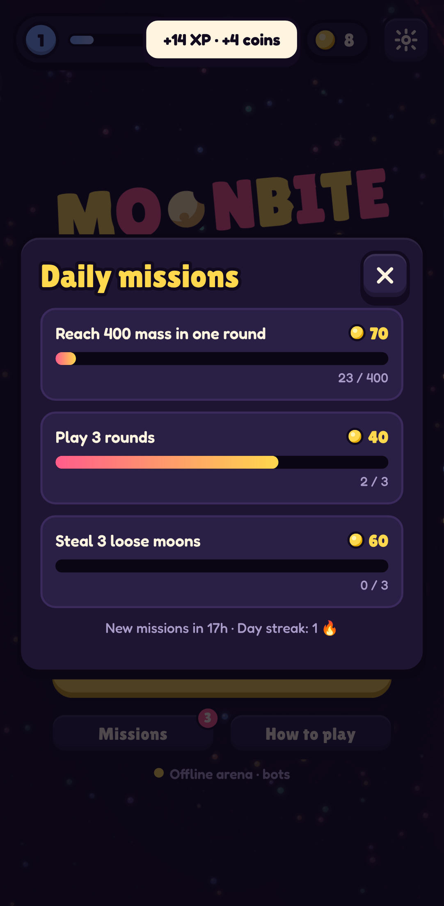

# Moonbite 🌙

**Spin your moons. Bite their core.** A fast multiplayer arena game for phones and the web, in the same competitive family as slither.io and paper.io but with its own mechanic: your moons are your teeth.

- 📱 Touch-first controls: a floating joystick on the left thumb, and you hold anywhere on the right to **Surge**. Desktop uses mouse or keyboard.
- 🌐 Authoritative multiplayer server, with an **offline arena of bots** used automatically when no server is reachable.
- 🎨 Hand-built "sticker arcade" art with 16 skins, expressive faces and synthesized audio. No external asset downloads apart from the bundled fonts.
- 🩸 **Blood Moon**: every few minutes the arena goes dark, the music turns to horror, every core turns hollow-eyed and **wraiths** hunt you. Grab a ☀ sunstone to turn Radiant and banish them. Deaths get freaky kill-cams with six randomized variants. Add `?bloodmoon` to the URL (offline) to trigger one about 7s after you spawn.
- 🔁 Progression: XP and levels, coins, skin unlocks, daily missions, a day streak and personal bests.

<p align="center">  </p>

See **[docs/GAME_DESIGN.md](docs/GAME_DESIGN.md)** for the full design.

## Quick start

```bash
npm install
```

Offline arena with bots, hot-reloading:

```bash
npm run dev
```

For online play during development, run the server in a second terminal (Vite proxies `/ws` to it):

```bash
npm run dev:server
```

Open http://localhost:5173. On a phone on the same Wi-Fi, use the Network URL that Vite prints.

### Production (single process: static client + WebSocket server)

```bash
npm run build
```

```bash
PORT=8080 REGION=eu-1 npm run start:server
```

Or with Docker:

```bash
docker build -t moonbite . && docker run -p 8080:8080 moonbite
```

`GET /healthz` reports rooms and player counts. The server fills the busiest room with space first, tops every room up to 18 cores with bots (and removes bots as humans arrive), and closes idle rooms.

### Native apps (Capacitor)

```bash
VITE_SERVER_URL=wss://your-server/ws npm run build
```

```bash
npx cap add android
```

```bash
npx cap add ios
```

```bash
npm run cap:android
```

```bash
npm run cap:ios
```

Native builds need `VITE_SERVER_URL`; without it they run the offline bot arena. Haptics use `@capacitor/haptics` natively and fall back to `navigator.vibrate` on the web. The web build is also an installable PWA (manifest plus service worker).

## Scripts

| Command | What it does |
|---|---|
| `npm run dev` | Vite dev server (client) |
| `npm run dev:server` | Game server with auto-reload |
| `npm run build` | Typecheck and production client build into `dist/` |
| `npm run start:server` | Serve `dist/` and the WebSocket at `/ws` |
| `npm test` | Vitest suite (simulation, combat, protocol, server room) |
| `npm run balance [secs]` | Headless bot-arena balance report |
| `npm run icons` | Re-render PNG app icons from `client/public/icon.svg` |

## Architecture

```
shared/     Deterministic game simulation, used by both client and server
  world.ts      cores, moons, dust grid, combat, starfall, bot respawns
  bot.ts        utility AI (farm / hunt / flee) with personalities
  constants.ts  every tuning number and growth formula
  protocol.ts   wire messages, validation, name sanitising
  codec.ts      compact positional-array encoding
server/     Node + ws: rooms at 30 Hz, 15 Hz snapshots, rate limiting, back-pressure
client/src/
  game/         Game orchestrator, LocalSession (offline), NetSession (interpolation + prediction)
  render/       Canvas2D renderer, character art, pooled particles
  ui/           DOM menus, HUD, death screen, modals, minimap, animated skin preview
  audio/        synthesized SFX and generative music (WebAudio)
  input/        floating joystick, hold-to-surge, mouse, keyboard
  meta/         profile, XP and levels, coins, skins, daily missions (localStorage)
```

- **One simulation, two hosts.** The offline mode runs the same `World` the server runs, so bots, balance and bugs behave the same in both.
- **Netcode.** The server is authoritative. Clients render remote entities 110 ms in the past and interpolate between snapshots. Your own core is predicted locally with the server's movement model and smoothly corrected. Sim events (bites, clashes, dust) are released on the interpolated timeline so the effects line up with what you see.
- **Performance.** Dust uses a spatial hash. Dust and moon sprites are pre-rendered. Particles are pooled with no per-frame allocation. Device pixel ratio is capped at 2 (1 on Low quality). The client bundle is about 38 KB gzipped.

## Controls

| | Touch | Desktop |
|---|---|---|
| Steer | Drag anywhere on the left side | Mouse, or WASD / arrows |
| Surge | Hold anywhere on the right side (can be swapped in Settings) | Hold click, or Space / Shift |
